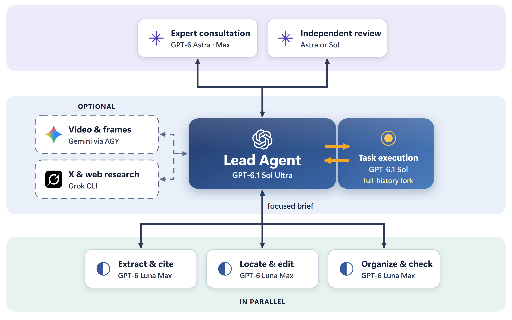

# subagent-manager

**English** | [简体中文](README.zh-CN.md)

Subagent Manager is a Skill that lets Codex lead a team of AI subagents. As the lead, it decides what is worth delegating, picks the right model for each piece, hands over the context it needs, and checks every result before it becomes part of the answer.

- **Parallel work, focused lead.** Long reading, data extraction, and routine edits run in their own contexts while the lead stays on the core analysis.
- **The right model for each job.** Sol takes on heavy execution, Astra gives expert consultation and independent review, and Luna Max takes routine work off the lead's plate. Gemini for video and Grok for X and web research plug in when you need them.
- **Handoffs that carry real context.** Every delegate gets the goal, the materials, the files it owns, and how its result will be checked, with either the full project history or a focused brief.
- **Every result is checked.** The lead verifies returned work against sources or tests before using it. Agreement between models does not count as proof.



Built mainly for Codex, from the workflow I use every day for research, writing, data work, and programming. This README is available in English and Chinese; the Skill and its reference guides are in English. The agent replies in your preferred language.

## What's new

- **Fuller context handoffs.** With `fork_turns: "all"`, a Sol delegate inherits the whole conversation, and independent consultations receive the original material rather than a short summary.
- **Always the latest rules.** The Skill carries a version number. The agent checks it at each new turn and after an interruption, and rereads the rules whenever they change.
- **Picks up after interruptions.** After an interruption or context compaction, the lead reuses delegates that can continue, keeps finished work, and reassigns only what is left.

## Model roles

A strong lead such as 6.1 Sol Ultra handles a lot on its own; it delegates when a separate context, parallel progress, or a second view is worth the time spent briefing and checking. Available models and effort levels depend on your Codex setup and account.

| Delegate | Role |
|---|---|
| **GPT-6.1 Sol** | Complex analysis, implementation, and substantive review, usually with the lead's full history |
| **GPT-6 Astra** | Expert consultation, independent review, and difficult execution, when there is a concrete reason to expect added value |
| **GPT-6 Luna Max** | Routine extraction, code location, small edits, and checks with clear criteria |
| **Gemini 3.8 Flash High** *(optional, via AGY CLI)* | Video understanding and related frame analysis, returning evidence and timestamps |
| **Grok CLI** *(optional)* | X posts and threads, plus web research and verification; a reminder appears when daily use passes 30% of the weekly allowance |

Effort levels, handoff rules, and recovery steps are in [model selection](skills/subagent-manager/references/native-models.md) and [task handoffs](skills/subagent-manager/references/delegation.md).

## Getting started

Codex's built-in subagents are enough to start:

1. Copy the `skills/subagent-manager/` folder into `$HOME/.agents/skills/` or your project's `.agents/skills/`. Choose one location, and compare any customized rules before replacing an existing copy.
2. Mention `$subagent-manager` in a task, or let Codex select it from context. If the Skill does not appear, restart Codex. See the [official Skill guide](https://learn.chatgpt.com/docs/build-skills).
3. Try a task and let the lead decide what to delegate:

```text
Use $subagent-manager to help review this technical plan.

The background materials are in ./materials/.
Extract the required fields and verify their source locations.
Determine which parts are worth delegating to subagents, and specify the
appropriate model, effort, and context handoff for each assignment.
The main agent should continue the core analysis and handle final review.
```

## Optional integrations

The Skill supplies working rules; it does not install tools or grant model access. When a model or interface is unavailable, Codex reports it and takes a workable path.

| Extension | Purpose | Requirements |
|---|---|---|
| [AGY / Gemini](skills/subagent-manager/references/google.md) | Analyze video and related frames, returning evidence to the lead | AGY CLI installed and signed in; PowerShell 7 for the wrapper script |
| [Grok](skills/subagent-manager/references/grok.md) | Investigate original posts, discussions, and web sources | Grok CLI installed and signed in, with free or subscription usage; this workflow uses only included, authorized usage |
| [Grok usage rules](skills/subagent-manager/references/grok-budget.md) | Check usage after grouped research units; remind above 30% daily use of the weekly allowance | Checks every 5 substantive research units by default; Python 3 for the snapshot ledger |
| [Windows proxy module](extras/windows-proxy/README.md) | Set a process-level proxy for a single CLI call | Not needed on a direct connection; otherwise supply your client's HTTP(S) or Mixed port |

## Adapting and documentation

Adjust model tiers, effort levels, and Grok budgets to your own access, tools, and schedule.

| Topic | Reference |
|---|---|
| Delegation decisions, handoffs, and review rules | [SKILL.md](skills/subagent-manager/SKILL.md) |
| Model candidates, effort levels, and benchmark limits | [Model selection](skills/subagent-manager/references/native-models.md) |
| Consultation, execution, review, nesting, and recovery | [Task handoffs](skills/subagent-manager/references/delegation.md) |
| Environment checks and configurable defaults | [Customization](docs/customization.md) |
| Practical notes and the background of revisions | [Experience notes](skills/subagent-manager/references/experience.md) |

Use it on its own or with [agent-search-booster](https://github.com/LiX-Works/agent-search-booster) for multi-source research. See [Releases](https://github.com/LiX-Works/subagent-manager/releases) for updates. Released under the [MIT license](LICENSE).
